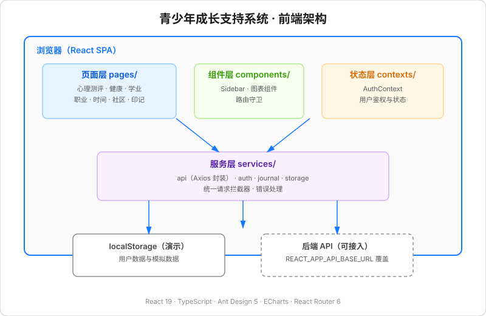

# 青少年成长支持系统

> 面向青少年心理健康、学业分析、职业规划与时间管理的综合性 Web 应用。


## 项目简介

青少年成长支持系统是一个覆盖青少年成长关键维度的综合性平台，围绕心理健康、身体健康、学业发展、职业规划、时间管理与自我记录等场景，提供可交互的测评工具与数据可视化能力，帮助青少年更系统地认识自我、规划成长。

## 功能模块

| 模块 | 说明 |
| --- | --- |
| 心理测评 | 集成 PHQ-9、GAD-7、SAS、SES、MSSmhs 等标准化量表，支持作答、结果解读与历史记录 |
| 健康管理 | 睡眠、运动、营养、心率、步数、体重、饮水等多维数据记录与可视化 |
| 学业分析 | 成绩记录、学科优劣势分析、成绩趋势图、时间分布与专注记录 |
| 时间管理 | 日程规划、专注时段、周计划视图与时间统计 |
| 职业规划 | 霍兰德职业兴趣测试、专业匹配与职业路径推荐 |
| 个性化学习 | 学习资源推荐与自适应学习计划 |
| 成长社区 | 匿名交流与内容发布 |
| 成长印记 | 多媒体日记、目标与成就徽章 |

## 技术栈

- **前端框架**：React 19 + TypeScript 4.9
- **UI 组件**：Ant Design 5
- **可视化**：ECharts 5、Recharts 2
- **路由**：React Router 6
- **HTTP 客户端**：Axios
- **样式**：styled-components 6
- **工程化**：Create React App 5

> 说明：本仓库为前端工程。鉴权与用户数据当前通过浏览器 `localStorage` 与内置模拟数据提供完整可交互演示；`src/services/api.ts` 已封装基于 Axios 的请求层（默认指向 `http://localhost:8080/api`，可通过环境变量 `REACT_APP_API_BASE_URL` 覆盖），便于接入后端服务。

## 快速开始

### 环境要求

- Node.js 16 及以上
- npm 8 及以上

### 安装依赖

```bash
npm install
```

### 启动开发服务器

```bash
npm start
```

应用运行于 [http://localhost:3000](http://localhost:3000)。

### 构建生产版本

```bash
npm run build
```

### 运行测试

```bash
npm test
```

## 项目结构

```
src/
├── components/    # 可复用组件与路由守卫
├── contexts/      # React Context（认证等）
├── layouts/       # 页面布局
├── pages/         # 页面（按业务域划分）
│   ├── academic/      # 学业分析与时间管理
│   ├── auth/          # 登录、注册、找回密码
│   ├── career/        # 职业规划与霍兰德测试
│   ├── community/     # 成长社区
│   ├── dashboard/     # 仪表盘
│   ├── health/        # 健康管理
│   ├── journal/       # 成长印记
│   ├── learning/      # 个性化学习
│   ├── psychological/ # 心理测评
│   └── errors/        # 错误页
├── services/      # API 服务与数据处理
├── styles/        # 全局样式与主题
├── types/         # TypeScript 类型定义
└── utils/         # 工具函数
```

## 架构



## 获奖情况

- **第39届天津市青少年科技创新大赛 二等奖**（B类个人作品，计算机科学学科）

## 许可证

本项目采用 [MIT License](LICENSE)。

## 作者

- [Kisly-Bai](https://github.com/Kisly-Bai)
